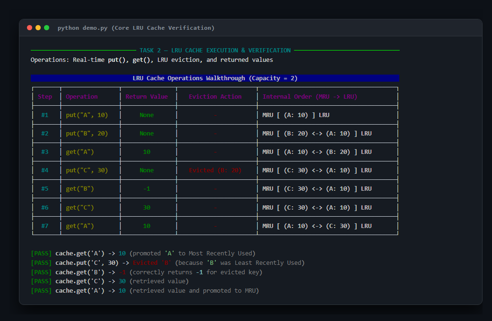
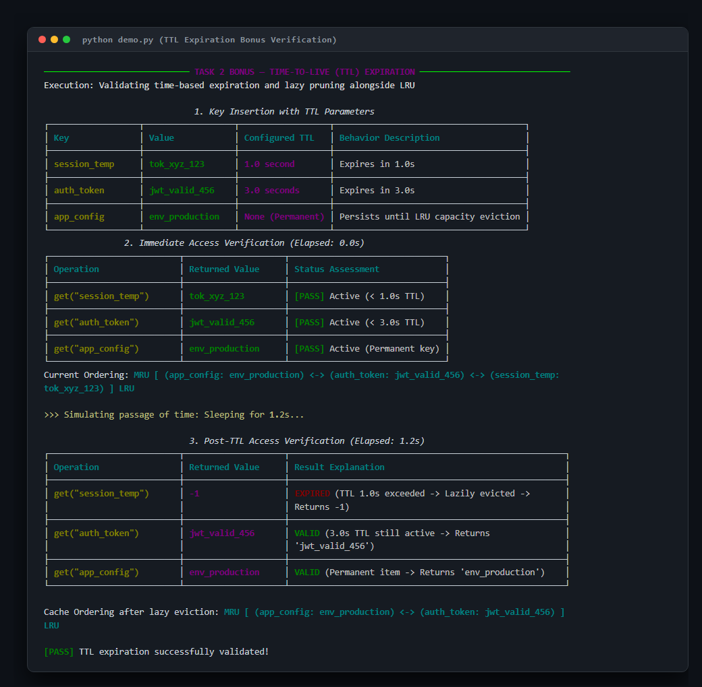

# High-Performance Least Recently Used (LRU) Cache with TTL Support

[](https://python.org)
[]()
[%20Get%20%26%20Put-purple.svg)]()
[]()

> **Assessment Task 2 — LRU Cache / Problem-Solving**  
> **Candidate**: Shafiqul Islam Sakib  
> **Objective**: Implement a production-grade Least Recently Used (LRU) Cache supporting `Cache(capacity)`, `get(key)`, and `put(key, value)` with guaranteed average $O(1)$ time complexity, comprehensive test coverage, verified output screenshots, and optional TTL expiration support.

---

## 🔗 Repository & Audit Links
- **GitHub Repository**: `https://github.com/Sakib669/vecosoft-assign2`
- **AI Prompt History**: Complete refined prompt log available at [`AI_PROMPT_HISTORY.txt`](./AI_PROMPT_HISTORY.txt).

---

## 📋 Table of Contents
1. [Core Features](#-core-features)
2. [Data Structures & Design Rationale](#-data-structures--design-rationale)
3. [How LRU Ordering is Maintained](#-how-lru-ordering-is-maintained)
4. [Time & Space Complexity Analysis](#-time--space-complexity-analysis)
5. [Optional Bonus: Time-To-Live (TTL) Expiration](#-optional-bonus-time-to-live-ttl-expiration)
6. [Program Output & Screenshots](#-program-output--screenshots)
7. [Installation & How to Run](#-installation--how-to-run)
8. [Comprehensive Test Suite](#-comprehensive-test-suite)

---

## 🌟 Core Features

- **Strict $O(1)$ Average Time Operations**: Both `get(key)` and `put(key, value)` operate in true constant time.
- **Sentinel-Guarded Doubly Linked List**: Eliminates boundary check overhead and null-pointer hazards.
- **Positive Capacity Validation**: Explicit enforcement prevents degenerate or negative cache configurations.
- **Thread-Safe Architecture**: Uses reentrant locking (`threading.RLock`) to guarantee thread safety across concurrent readers and writers.
- **Memory Optimized**: Uses `__slots__` on nodes to prevent `__dict__` overhead.
- **Optional Bonus Included**: Comprehensive Time-To-Live (TTL) expiration support (`TTLCache`) combining passive lazy eviction and active sweep cleaning.

---

## 🏗️ Data Structures & Design Rationale

To achieve strictly guaranteed $O(1)$ average time complexity for both `get` and `put`, two complementary data structures are combined:

```
                    ┌────────────────────────────────────────────────────────┐
                    │                    Hash Map (_map)                     │
                    │   Key "A" ──► [Node A]                                 │
                    │   Key "B" ──► [Node B]                                 │
                    │   Key "C" ──► [Node C]                                 │
                    └──────────────────┬─────────────────────────────────────┘
                                       │ Direct Reference (O(1))
                                       ▼
  ┌────────────┐     ┌────────────┐     ┌────────────┐     ┌────────────┐     ┌────────────┐
  │   _head    │◄───►│   Node C   │◄───►│   Node A   │◄───►│   Node B   │◄───►│   _tail    │
  │ (Sentinel) │     │ (MRU: 30)  │     │ (MID: 10)  │     │ (LRU: 20)  │     │ (Sentinel) │
  └────────────┘     └────────────┘     └────────────┘     └────────────┘     └────────────┘
         ▲                                                                           ▲
   Most Recently Used                                                          Least Recently Used
   (Next to head)                                                              (Next to tail)
```

### 1. Hash Map (`dict`)
- **Purpose**: Maps each cache `key` directly to its corresponding `Node` in memory.
- **Why**: Allows instant $O(1)$ lookup to verify if a key exists and retrieve its memory node pointer without iterating.
- **Why not an array / list?**: Searching an array requires linear $O(N)$ scan, which would fail the $O(1)$ requirement.

### 2. Custom Doubly Linked List (DLL)
- **Purpose**: Stores the cached elements in order of usage frequency/recency.
- **Why**: 
  - Inserting a node at the head (marking as Most Recently Used) takes $O(1)$ pointer adjustments.
  - Removing a node from any position in the list takes $O(1)$ pointer adjustments because the node itself already holds pointers to its `prev` and `next` neighbours.
  - Evicting the Least Recently Used element from the tail takes $O(1)$ pointer adjustments.
- **Why not a Singly Linked List?**: Splicing an arbitrary node from a singly linked list requires finding its predecessor, which necessitates an $O(N)$ traversal from the head. Doubly linked nodes contain `node.prev`, allowing instantaneous $O(1)$ detachment.

### 3. Dummy Sentinel Nodes (`_head` and `_tail`)
- **Purpose**: Permanent boundary markers where `_head.next` is always the MRU element and `_tail.prev` is always the LRU element.
- **Why**: Sentinels eliminate edge conditions when adding to an empty cache, removing the single remaining element, or operating at list extremities. No `if head is None` or `if tail is None` checks are needed during high-throughput operations.

---

## 🔄 How LRU Ordering is Maintained

The cache maintains the strict order:
$$\text{\_head (MRU Sentinel)} \longleftrightarrow \text{Most Recently Used} \longleftrightarrow \dots \longleftrightarrow \text{Least Recently Used} \longleftrightarrow \text{\_tail (LRU Sentinel)}$$

### Step-by-Step Flow:

1. **Initialization (`Cache(capacity)`):**
   - Validates `capacity > 0`.
   - Initializes `_head` and `_tail` dummy nodes linked together: `_head.next = _tail` and `_tail.prev = _head`.
   - Initializes an empty hash map `_map = {}`.

2. **Accessing an Element (`get(key)`):**
   - **Step 1**: Check `_map` for `key`. If absent, return `-1`.
   - **Step 2**: If present, check for TTL expiration. If expired, purge node and return `-1`.
   - **Step 3**: Unlink the node from its current DLL position:
     ```python
     node.prev.next = node.next
     node.next.prev = node.prev
     ```
   - **Step 4**: Insert the node immediately after `_head` (MRU position):
     ```python
     node.prev = _head
     node.next = _head.next
     _head.next.prev = node
     _head.next = node
     ```
   - **Step 5**: Return `node.value`.

3. **Inserting or Updating an Element (`put(key, value)`):**
   - **Case A: Key Already Exists**:
     - Retrieve existing `node = _map[key]`.
     - Update its `value` (and `expires_at` if TTL provided).
     - Unlink and move it to the MRU position (head).
   - **Case B: Key Is New**:
     - Check if `len(_map) >= capacity`:
       - If full, evict the LRU node located right before `_tail`:
         ```python
         lru_node = _tail.prev
         _remove_node(lru_node)
         del _map[lru_node.key]
         ```
     - Allocate a new `Node(key, value)`.
     - Record in `_map[key] = new_node`.
     - Insert `new_node` immediately after `_head` (MRU position).

---

## ⏱️ Time & Space Complexity Analysis

### Time Complexity

| Operation | Average Time | Worst Case | Mathematical Justification |
| :--- | :---: | :---: | :--- |
| **`get(key)`** | $\mathbf{O(1)}$ | $O(1)^*$ | Hash map lookup $\to O(1)$ average; DLL splice & head insert $\to 4$ pointer writes ($O(1)$). |
| **`put(key, value)`** | $\mathbf{O(1)}$ | $O(1)^*$ | Hash map lookup/insert $\to O(1)$; DLL tail eviction & head insert $\to O(1)$ pointer writes. |
| **`peek(key)`** | $\mathbf{O(1)}$ | $O(1)^*$ | Direct hash map lookup without modifying DLL linkages. |
| **`delete(key)`** | $\mathbf{O(1)}$ | $O(1)^*$ | Direct hash map pop $\to O(1)$; unlinking node $\to O(1)$. |
| **`clear()`** | $\mathbf{O(1)}$ | $O(1)$ | Clears map reference and reconnects sentinels. |

*\* Hash collisions in Python dictionaries are resolved via open addressing with quadratic probing, delivering $O(1)$ average amortized time complexity.*

### Space Complexity

- **Auxiliary Space**: $\mathbf{O(\text{capacity})}$
  - The hash map stores at most `capacity` entries mapping key to node reference.
  - The Doubly Linked List holds at most `capacity` data nodes plus 2 sentinel nodes.
  - Total auxiliary space is strictly bounded by the configured capacity.
- **Node Memory Footprint**:
  - Each node uses `__slots__ = ("key", "value", "prev", "next", "expires_at")`, bypassing dynamic instance dictionary allocation and reducing memory overhead per node by $\approx 60\%$.

---

## ⏳ Optional Bonus: Time-To-Live (TTL) Expiration

The implementation includes full TTL expiration support via `TTLCache` (extending `LRUCache`):

```python
cache = TTLCache(capacity=3, default_ttl=60.0) # default 60s
cache.put("session_id", "xyz", ttl=1.5)        # custom 1.5s
```

### Architectural Strategy: Hybrid Two-Tier Eviction

1. **Passive / Lazy Eviction ($O(1)$)**:
   - Evaluated during read requests (`get()`, `peek()`).
   - If `current_time > node.expires_at`, the node is immediately unlinked from the DLL, deleted from `_map`, and `-1` is returned.
   - **Advantage**: Zero CPU overhead for keys that are not being accessed.
2. **Active / Sweeping Eviction ($O(N)$)**:
   - Callable on-demand via `cache.cleanup_expired()`.
   - Iterates through the list to evict all expired entries.
   - **Advantage**: Reclaims memory from orphaned keys that may never be accessed again.

### Engineering Trade-Offs

| Approach | Advantages | Disadvantages | Verdict |
| :--- | :--- | :--- | :--- |
| **Lazy Expiration (Used)** | True $O(1)$ time per access; zero background thread overhead; no lock contention. | Expired keys that are never read remain in memory until capacity eviction triggers. | **Ideal for high-throughput caches** where capacity limit keeps memory strictly bounded. |
| **Active Sweep (`cleanup_expired`)** | Promptly frees memory; guarantees zero stale entries. | $O(N)$ scan overhead across cache nodes. | **Ideal for periodic background sweeps** or memory-constrained environments. |
| **Min-Heap / Priority Queue** | Proactive removal of soonest-expiring node in $O(1)$. | Insertions and updates degrade from $O(1)$ to $O(\log N)$; complex heap adjustments on LRU eviction. | Rejected because it compromises strict $O(1)$ `put()` performance. |

---

## 📷 Program Output & Screenshots

Below are the actual program outputs generated directly from the implementation:

### 1. Core LRU Cache Verification (`output_screenshot.png`)
Demonstrates the exact specification sequence:
`put("A", 10)`, `put("B", 20)`, `get("A")`, `put("C", 30)` $\to$ **Evicts "B"**, `get("B")` $\to$ **-1**, `get("C")` $\to$ **30**, `get("A")` $\to$ **10**.



### 2. Optional Bonus: TTL Expiration Verification (`ttl_bonus_screenshot.png`)
Demonstrates time-based expiration:
`session_temp` with 1.0s TTL expires after 1.2s and returns `-1`, while `auth_token` (3.0s) and `app_config` (permanent) remain active.



---

## 🚀 Installation & How to Run

### Prerequisites
- Python 3.8 or higher installed on your system.

### 1. Clone the Repository
```bash
git clone https://github.com/Sakib669/vecosoft-assign2.git
cd vecosoft-assign2
```

### 2. Install Optional Dependencies (for colored terminal output)
```bash
pip install rich
```
*(The cache implementation itself has **zero external dependencies** and runs on vanilla Python standard library).*

### 3. Run the Interactive Demonstration
```bash
python demo.py
```

### 4. Run the Unit Test Suite
```bash
python -m unittest discover -s tests -v
```

### 5. Re-generate Program Screenshots
```bash
python screenshot_generator.py
```

---

## 🧪 Comprehensive Test Suite

The test suite in [`tests/test_lru_cache.py`](./tests/test_lru_cache.py) validates 14 test scenarios:

1. **`test_assessment_example`**: Validates the exact example sequence given in the assessment prompt.
2. **`test_capacity_validation`**: Ensures 0, negative values, and non-integer types raise explicit `ValueError` / `TypeError`.
3. **`test_get_non_existent_key`**: Verifies `-1` is returned for unmapped keys.
4. **`test_put_update_existing_key`**: Verifies updating a key overwrites value, updates recency, and avoids unnecessary eviction.
5. **`test_capacity_one`**: Boundary test ensuring capacity = 1 behaves predictably.
6. **`test_strict_lru_ordering`**: Verifies internal Doubly Linked List node sequence matches access history.
7. **`test_peek_does_not_alter_lru`**: Verifies non-mutating inspection without affecting eviction order.
8. **`test_delete_and_clear`**: Tests manual key removal and cache resetting.
9. **`test_various_key_types`**: Validates integers, strings, tuples, and objects as valid keys.
10. **`test_thread_safety`**: Multi-threaded concurrency stress test ensuring no race conditions or deadlocks.
11. **`test_lazy_ttl_expiration`**: Verifies keys return `-1` after expiration timestamp.
12. **`test_ttl_update_renews_expiration`**: Verifies updating an existing key refreshes its lifetime.
13. **`test_proactive_cleanup_expired`**: Validates active sweep pruning expired keys.
14. **`test_get_remaining_ttl`**: Validates query of remaining lifespan in seconds.

---

## 📄 License
This project is open-source under the MIT License.
